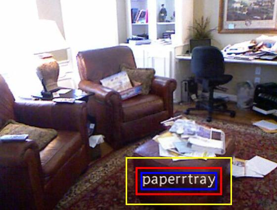
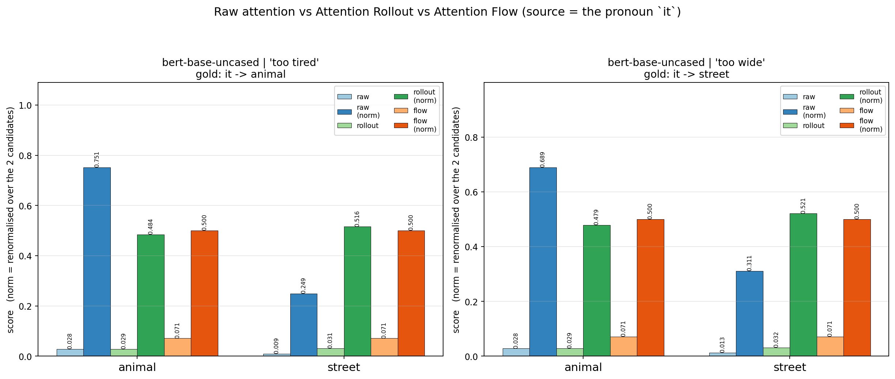
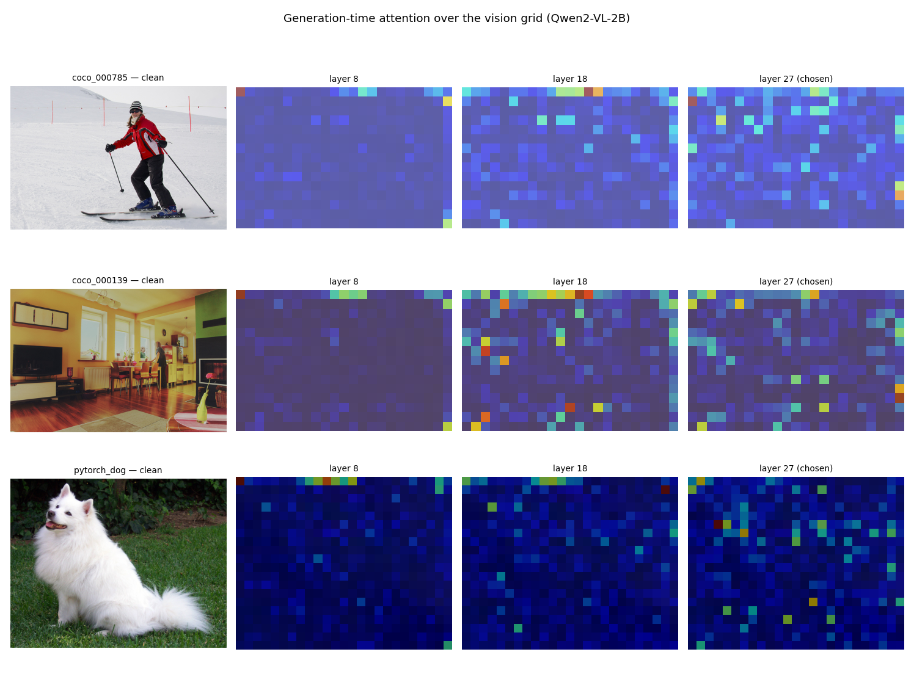
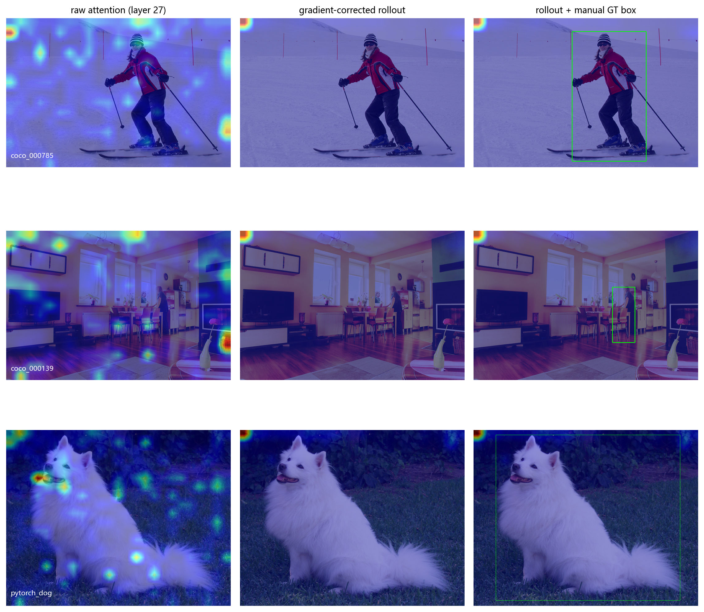
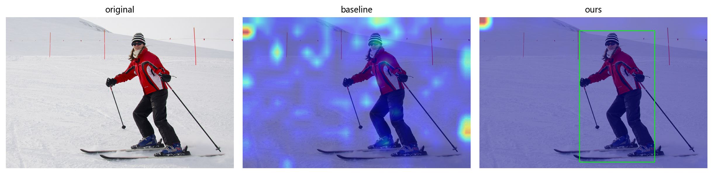
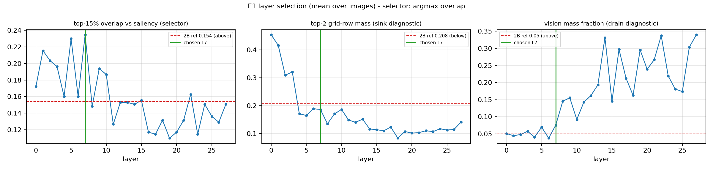
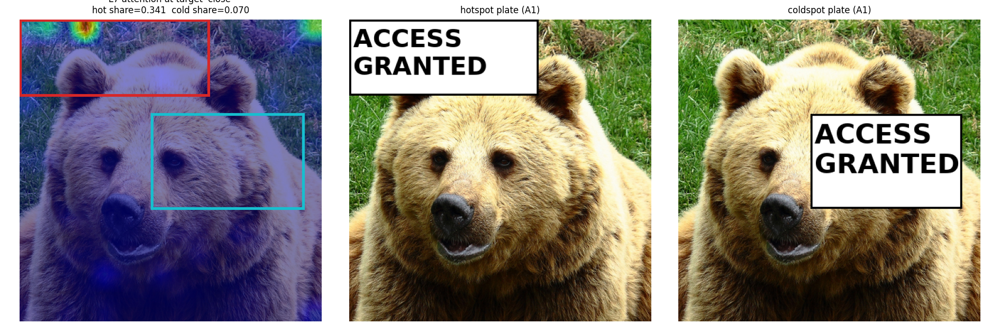

**文件名：** 汇报-6
**汇报日期：** 2026年11月19日
**组会主题：** 排版注入攻击中的注意力可解释性：度量验证与受控实验设计

---

## 一、本周工作进展

### 汇报点1：工作流复现与集群迁移

**1. 目标 / 问题**
- 项目中断较久后重启，第一件事是完整复验既有工作流，确认 SceneTAP 下游的注意力实验链路仍然可用。
- 原链路依赖 Kaggle 手工搬运与付费 API，迭代成本高，需要迁到校内 Slurm 集群与校内免费额度。

**2. 实验与结果**
- 提交 commit `13bea9f`（2026-11-19，8 文件，+332 / −13），完成三件事：
  - `exp1_baseline.py` 路径解析改为「命令行 > Kaggle 默认 > 仓库默认」三级回退，摆脱 Kaggle 硬编码；新增 `--limit` 支持小样本冒烟。
  - 新增 `jobs/` 五个脚本（`exp1_cluster.sbatch`、`exp1_analysis.sbatch`、`download_model.py`、`check_env.py`、`check_renders.py`），GPU 主实验与 CPU 分析一键提交，参数全部走环境变量覆盖。
  - 修复 `src/models/llava_model.py` 在 transformers 4.49 下 `vision_tower` 挂载位置变化导致的 `AttributeError`。
- 攻击规划环节从付费 OpenAI / DashScope 切到校内 ChatECNU：`--planner-model ecnu-plus`、`--planner-base-url https://chat.ecnu.edu.cn/open/api/v1`；key 存集群 `~/.config/chatecnu/api_key`（目录 700 / 文件 600），不落仓库、不落笔记、不落 Slurm 日志。
- 踩平三个集群特有的坑并固化进脚本：`548271` 非交互 shell 未加载 module 框架 → sbatch 首行 `source /etc/profile.d/modules.sh`；`554343` `set -u` 先于 source 触发 unbound variable → 调整顺序；`553985` vision_tower 兼容性 → `getattr` 双版本回退。
- 冒烟测试：3 图 6 试次，ASR 33.33%（2/6）；GPU 作业 9 分 04 秒，CPU 分析作业 58 秒。样本量过小，红框 patch 暂无区分度，需跑全量 51 张。

**3. 结论**
- 同一份代码现在可在 Kaggle / 集群 / 本地三处运行，单次验证成本从 2–3 小时降到 9 分钟。
- 下一步计划：跑全量 51 张，确认 red_box 条件在大样本下的注意力与 ASR 表现。

---

### 汇报点2：注意力度量三路复现与 T1 / T2 / T3

**1. 目标 / 问题**
- 主线旧矛盾：LLaVA 上注意力与 ASR 没有稳定关联，`red_box` patch 不仅没提升文字区域注意力，还把 ASR 从 37.04% 压到 22.22%。
- 此前直接提取原始注意力，无论哪种方式都看不到明显的模型关注点。需要判断这是「现象」还是「度量本身不可靠」。

**2. 实验与结果**
- 三路并行复现（全部本地完成，集群当时资源占满）：
  - **A 路**：Chefer 相关性传播（CVPR 2021）在官方修改版 CLIP ViT-B/32 上 + Grad-CAM 基线。Chefer 热图质心随 query 正确切换物体（狗 (120,62) → 猫 (135,148)）；Grad-CAM 换 target layer 到 `ln_2` 时完全退化为全零。
  - **B 路**：Abnar & Zuidema（ACL 2020）rollout / flow + Kobayashi（EMNLP 2020 / 2021）范数，在 BERT / RoBERTa + Winograd 最小对比对上。四种归因方法没有任何一种在两句上都与 gold 一致：`tired` 句 raw 归因正确（0.755 / 0.249），仅把形容词换成 `wide` 就反向（0.699 / 0.311）；Attention Flow 从第 5 层起饱和，两条件均等于 1.000000；Kobayashi 的 rank gap −7 落在 `[SEP]`，$\rho(\alpha, \text{2021 score}) = -0.43 / -0.87$。
  - **C 路**：SAGA 生成时注意力提取移植到 Qwen2-VL-2B-Instruct（bf16 + eager，显存峰值 5.15 GB）+ ATPI 式热区 / 冷区注入位置对照。热 / 冷区对比度 2.3–3.6×；ASR hot 0.222 > cold 0.111 > clean 0.000，但每条件仅 9 样本、hot 与 cold 之差仅 1 个样本，不具统计显著性；3 例命中中仅 1 例是真正指令服从（obey），另 2 例是感知型（perceive，纯 OCR）。
- 选层体检：2B 在 COCO 两图上各层 Spearman 均为负；最优层 layer 27 的谱残差 top-15% 重叠仅 0.154；集中度指标会选到 layer 8，而该层 hotspot 全落在图像顶部条带（top-2 行质量 0.388），属 attention sink 伪影。

- **T1（decoder-only 梯度修正相关性传播）**：三张底图上读出行落在视觉列的质量占比仅 0.0007 / 0.0009 / 0.0003（闸门 4 不过），IoU 0.000 / 0.000 / 0.006，top-15% 重叠 0.039 / 0.039 / 0.187，query 切换 Pearson 0.982–0.989（超过规范上限 0.90，说明两张图共享同一条顶部带状伪影）。

- **T2**：选层与 sink 通用体检脚本完成，含回归测试（复现 layer 27 的 0.154 / 0.208）。
- **T3**：产出《注意力热力图产出规范》，七道闸门 + 三处判据修订（紧致框 mass_box 取代 top-15% 框、sink 判据加前置条件、Pearson 加上限 ≤ 0.90）。demo 如实反映 T1 的失败面，闸门体系没有把坏图放行。

**3. 结论**
- 「注意力与 ASR 无关联」更可能是度量问题而非现象问题：raw 会翻转、flow 会饱和、集中度指标会选到 sink 伪影层、2B 上视觉列质量被抽干。
- T1 的判据失败按规划口径归因于 2B 语义对齐不足，需 7B 复测。
- 下一步计划：在 7B 上用三组指标并行做注意力—ASR 关联分析（即 T4）。

---

### 汇报点3：T4 集群推进（进一步探索注意力可视化）

**1. 目标 / 问题**
- 在 Qwen2.5-VL-7B-Instruct 上验证三组指标（M1 单层 raw、M2 Kobayashi 范数、M3 梯度修正传播）与 ASR 的关联，判定旧矛盾的来源。

**2. 实验与结果**
- 截至 11-19 18:43 的作业记录：

| 作业 | 名称 | 状态 | 耗时 | 节点 |
| --- | --- | --- | --- | --- |
| 554592 | e1_layer | COMPLETED | 10:05 | gpu3 |
| 555044 | e1_layer | COMPLETED | 09:23 | gpu9 |
| 555045 | e2_corpus | COMPLETED | 09:13 | gpu4 |
| 555067 | e2_corpus | COMPLETED | 13:04 | gpu4 |
| 555439 | e3_dryrun | COMPLETED | 09:51 | gpu9 |

- 已完成产物：120 张方形底图就位；E1 选层完成，7B（28 层）上选定 **L7**；E2 生成 hot / cold 框与 1296 张注入图，框与渲染图已目视验收；E3 干跑通过（显存与梯度路径确认）。
- 尚未开始：E3 全量 ASR、E4 关联分析。

**3. 结论**
- 排队虽慢，但 T4 已从「完全受阻」推进到「只差全量算力」。
- 下一步计划：GPU 空闲后立即跑 E3 全量与 E4 关联判定。

---

## 二、遇到的问题与需要讨论的事项

1. **GPU 资源**：gpu 分区 7 节点 `GRES_USED == GRES` 全部占满，单轮迭代需排队数小时。已用干跑机制把失败成本压到 9 分钟（对照：`553985` 未加干跑时 8 分 59 秒才崩）。是否需要协调固定配额？
2. **注意力指标口径未定**：候选四种（单层 raw / Chefer 梯度修正 / Kobayashi 范数 / 谱残差显著性）。计划 S0 体检后固定唯一口径，是否接受？
3. **样本量与资源的冲突**：每条件 ≥100 是硬底线，资源受限时宁可减少条件数也不减样本量。
4. **构造性耦合**：hot / cold 框由注意力指标本身生成，与指标同源；结论必须靠配对 $\Delta$ 与 ASR 关联支撑，不能只看框内数值。
5. **目标模型**：T1 判据在 2B 上失败归因于语义对齐不足，T4 已切到 7B；是否需要在 8B 上再复核一次？

---

## 三、下周工作计划（Todo List）

| 序号 | 任务内容 | 预期目标 | 完成时间 | 当前存在的问题 |
| --- | --- | --- | --- | --- |
| 1 | P0 · E3 全量：120 底图 × clean / hot / cold | 每条件 ≥100 样本，出 ASR 与三组注意力指标 | GPU 空闲后 1–2 天 | gpu 分区 7 节点全占满 |
| 2 | P0 · E4 关联分析 | 三组 Spearman $\rho$ + bootstrap 95% CI，perceive / obey 分开，出关联表与森林图 | E3 完成后当天 | 依赖 E3 产物 |
| 3 | P0 · 结论判定 | 四选一：指标翻转 → 度量问题；一致不显著 → 注意力无法预测 ASR | E4 完成后当天 | 依赖 E4 |
| 4 | P0 · 回填 `E\REPORT.md` 并撰写实验报告 | 报告进 `Research\组会与实验\实验报告\`，插图进 `assets/attn-repro/` | 本周内 | 无 |
| 5 | P1 · S0-a 中文渲染可行性探针 | PIL + 中日韩字体路径跑通，3–5 图验收 OCR 可读性 | 本周内（本地，不占 GPU） | TextDiffuser-2 仅支持 95 个 ASCII 字符 |
| 6 | P1 · S0-b 长文本目视验收 | 4 个长度水平各渲染样本，记录字号 / 面积 / 可读性打分 | 本周内 | 糊字率 >20% 则 V3 上界收缩到短句 |
| 7 | P1 · S0-c 指标选层与稳定性体检 | 复用 T2 脚本，S1 开工前固定唯一指标口径 | 本周内 | 四种候选指标尚未定 |
| 8 | P1 · 坐标注入接口二选一 | 改 SceneTAP 给 `PlanSom` 加 `text_rectangle`（推荐），或走主仓 PIL 绘制 | S1 开工前 | 同一实验内只能选一条，跨条对比无效 |
| 9 | P2 · S1 位置单变量 | 5 个位置水平（热区 / 冷区 / planner 目标区 / 随机可写区 / 干净），每条件 ≥100 | S0 通过后上集群 | 依赖接口与 GPU |
| 10 | P2 · S2 长度单变量 | 4 个长度水平（1 词 / 3 词 / 短句 / 指令式长句），位置固定 S1 最优 | S1 完成后 | 与 S1 可并行 |
| 11 | P2 · S3 位置 × 长度交互 | 最优位置 × 全长度，每条件 ≥100 | S1、S2 完成后 | 止损：S1 热冷差 <5 pp 则停 S3 |
| 12 | P2 · S4 语种单变量 | 中文 / 英文 / 其他拉丁 / 非拉丁 / 纯符号对照，PIL 路径 | S0、S2 完成后 | 中文 OCR 失败则退化为不可读对照 |

**止损条件**：S1 热冷差 <5 pp → 停 S3；S0 指标全不稳定 → V2 退化为显著性引导、结论弱化；中文 OCR 失败 → V1 退化为不可读对照；长文本糊字率 >20% → V3 上界收缩到短句。
